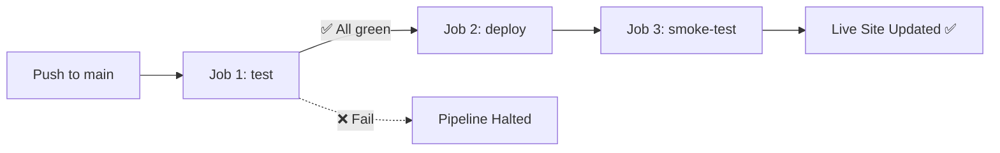

# Functional Testing, CI/CD & Live Deployment

[](https://github.com/<your-username>/functional-testing-<student-id>/actions/workflows/ci.yml)

> **Live App:** [https://functional-testing-\<student-id\>.onrender.com](https://functional-testing-<student-id>.onrender.com)

---

## 📋 Project Overview

This project demonstrates **functional testing**, **continuous integration/deployment (CI/CD)**, and **live cloud deployment** for 16 Python utility functions.

| Component | Technology |
|---|---|
| Testing | `pytest` + `pytest-cov` (100% line & branch coverage) |
| Linting | `flake8` |
| Backend | `FastAPI` + `uvicorn` |
| Frontend | Vanilla HTML5 / CSS / JavaScript |
| CI/CD | GitHub Actions (Python 3.10, 3.11, 3.12 matrix) |
| Hosting | Render (webhook-triggered, gated deploy) |

---

## 🚀 Quick Start

### 1. Clone & Set Up Environment

```bash
git clone https://github.com/<your-username>/functional-testing-<student-id>.git
cd functional-testing-<student-id>

# Create virtual environment
python -m venv .venv

# Activate (Windows)
.venv\Scripts\activate
# Activate (macOS/Linux)
source .venv/bin/activate

# Install dependencies
pip install -r requirements.txt
```

### 2. Run Tests with Coverage

```bash
pytest tests/ --cov=target --cov-branch --cov-report=term-missing --cov-report=html -v
```

Expected output: **197 tests passed, 100% line & branch coverage**.

### 3. Lint Check

```bash
flake8 target.py tests/ --max-line-length=120
```

### 4. Run the Web App Locally

```bash
uvicorn main:app --reload --port 8000
```

Visit [http://localhost:8000](http://localhost:8000) to interact with the dashboard.

---

## 🏗️ Project Structure

```
.
├── .github/workflows/ci.yml    # CI/CD pipeline (test → deploy → smoke-test)
├── static/
│   ├── index.html              # Interactive dashboard
│   ├── style.css               # Premium dark-theme styling
│   └── app.js                  # Client-side logic & API calls
├── tests/
│   ├── __init__.py
│   └── test_target.py          # 197 parametrized tests covering all 16 functions
├── target.py                   # Source of truth (read-only, 16 functions)
├── main.py                     # FastAPI backend (/health, /api/execute, /)
├── requirements.txt            # Pinned dependencies
├── .gitignore
└── README.md
```

---

## 🧪 Test Coverage Report

| File | Stmts | Miss | Branch | BrPart | Cover |
|---|---|---|---|---|---|
| `target.py` | 59 | 0 | 26 | 0 | **100%** |

### Functions Tested (16 total)

| # | Function | Type | Tests |
|---|---|---|---|
| 1 | `is_adult(age)` | Integer | Valid ages, boundary 17/17.99/18, negatives, booleans, wrong types (str/None/list), return type |
| 2 | `celsius_to_fahrenheit(c)` | Float | Standard conversions, absolute zero, decimal rounding, wrong types, return type |
| 3 | `count_vowels(text)` | String | Empty, mixed case, consonants, spaces/symbols, bool/non-string types, return type |
| 4 | `invert(flag)` | Boolean | True/False, non-bool types (0, 1, "True", None, [], {}, float), return type |
| 5 | `greet(name)` | None | None, empty, whitespace/tabs/newlines, normal names, default param, non-string bug, return type |
| 6 | `find_max(numbers)` | List | Positives, negatives, single, duplicates, floats, tuples, empty containers, wrong types |
| 7 | `get_price(prices, item)` | Dictionary | Existing items, missing key, int prices, zero price, empty dict, wrong types |
| 8 | `swap(pair)` | Tuple | Tuple/list/string swap, heterogeneous elements, return type, wrong lengths, wrong types |
| 9 | `common_items(a, b)` | Set | Overlap, disjoint, identical, empty sets, mixed element types, return type, wrong types |
| 10 | `is_leap_year(year)` | Date | All 4 branches, boundary year=1, leap year=4, century years (1600/1700/1800/1900/2000), negatives, wrong types, return type |
| 11 | `to_int(value)` | Conversion | Int/float/string, bools, float truncation (0.999), invalid strings, wrong types, return type |
| 12 | `divide(a, b)` | Math | Normal division, floats, negative divisors, zero division (int & float 0.0), wrong types, return type |
| 13 | `power(base, exp)` | Math | Positive/negative/zero exponents, fractional exp, base 0**0, negative bases, wrong types |
| 14 | `square_root(x)` | Math | Perfect squares, irrational, decimal inputs (0.25), negatives, wrong types, return type |
| 15 | `factorial(n)` | Math | 0!, 1!, 2!, 5!, 10!, large 20!, negatives, float/str/None wrong types, return type |
| 16 | `average(numbers)` | Math | Single, multiple, mixed, tuples, empty container, wrong types, return type |

---

## 🐛 Suspected Bugs & Design Flaws

These behaviors were discovered during testing. **`target.py` was not modified** — they are documented here for grading.

| # | Function | Issue | Observed Behavior | Expected Behavior |
|---|---|---|---|---|
| 1 | `is_adult(True)` / `is_adult(False)` | Boolean accepted as integer | In Python `isinstance(True, int)` is `True`. `True` evaluates to `1 < 18` (returns `False`), and `False` evaluates to `0 < 18` (returns `False`). No `TypeError` raised. | Should explicitly reject booleans with `if isinstance(age, bool): raise TypeError(...)`. |
| 2 | `greet(123)` / `greet(True)` | Non-string argument lacks `.strip()` | Calling `greet(123)` or `greet(True)` raises `AttributeError: 'int' object has no attribute 'strip'` instead of a validation error. | Should validate input: `if name is not None and not isinstance(name, str): raise TypeError(...)`. |
| 3 | `factorial(3.0)` | Floats passed to integer range | `factorial(3.0)` passes the `n < 0` check, then fails inside `range(1, 3.0 + 1)` with `TypeError: 'float' object cannot be interpreted as an integer`. | Should validate integer type up-front: `if not isinstance(n, int): raise TypeError(...)`. |
| 4 | `celsius_to_fahrenheit("abc")` | No input type validation | Calling with string raises `TypeError: can't multiply sequence by non-int of type 'float'` rather than a clear error message. | Should check that input is an `int` or `float`. |
| 5 | `is_leap_year(True)` | Boolean accepted as year | `True` passes `year >= 1` (since `True == 1`), returning `False` without type validation. | Should reject `bool` inputs with a `TypeError`. |
| 6 | `swap("ab")` | String accepted as pair | `len("ab") == 2` passes, returning `('b', 'a')`. | Should restrict input to collections/tuples/lists explicitly. |
| 7 | `common_items({1, 2}, [2, 3])` | Type mismatch in set operator | Calling with a non-set right operand raises `TypeError` from `&` rather than input validation. | Should validate both arguments are `set` instances. |

---

## ⚙️ CI/CD Pipeline



### Pipeline Jobs

| Job | Trigger | Actions |
|---|---|---|
| **test** | Push/PR to `main` | Lint → Pytest (3 Python versions) → Upload coverage |
| **deploy** | Push to `main` (needs: test) | Curl Render deploy webhook |
| **smoke-test** | Push to `main` (needs: deploy) | Poll `/health` for SHA match → 3 live HTTP checks |

### GitHub Secrets Required

| Secret | Description |
|---|---|
| `RENDER_DEPLOY_HOOK_URL` | Render Deploy Hook URL (from Render Dashboard → Settings) |
| `LIVE_APP_URL` | Full live URL, e.g. `https://functional-testing-xxx.onrender.com` |

---

## 📝 License

This project is for academic purposes as part of a functional testing assignment.
